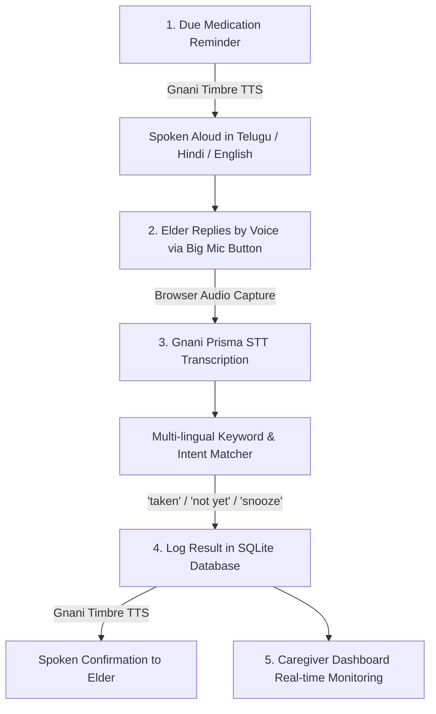

# 💊 VoiceDose — Voice-First Medication Reminder for Elders

> A voice-first, multi-lingual medication assistant for elderly people powered by **Gnani AI's Inya VoiceOS (Timbre TTS & Prisma STT)**, built with **Python (FastAPI)**, **HTML5/JS**, and **SQLite**.

Supports **Telugu (తెలుగు)**, **Hindi (हिंदी)**, and **English**.

---

## 🌟 The Flow



1. **Spoken Reminder:** When a dose is due, the reminder is spoken aloud in the chosen language (Telugu, Hindi, or English) using **Gnani Timbre TTS** (`timbre-v3.0`, voice `Shivani`).
2. **Elder Voice Reply:** The elderly patient answers by clicking the large, friendly microphone button in their browser.
3. **Speech Recognition & Intent Matching:** The recorded voice goes directly to **Gnani Prisma STT** (`POST https://api.vachana.ai/stt/v3`). The recognized transcript is matched against keyword lists across Telugu, Hindi, Hinglish, and English for:
   - **"taken"** (e.g. *"వేసుకున్నాను"*, *"దवाई ले ली"*, *"le liya"*, *"I took it"*)
   - **"not yet"** (e.g. *"తీసుకోలేదు"*, *"ఇంకా లేదు"*, *"अभी नहीं ली"*, *"nahi liya"*, *"haven't taken"*)
   - **"snooze"** (e.g. *"తర్వాత"*, *"పది నిమిషాల తర్వాత"*, *"दस मिनट बाद"*, *"baad mein"*, *"remind me later"*)
4. **Log & Spoken Confirmation:** The outcome is logged in SQLite, and a warm, comforting confirmation is spoken back to the elder using **Gnani Timbre TTS**.
5. **Caregiver Monitoring:** A dedicated caregiver dashboard displays today's doses as **Taken**, **Pending**, **Snoozed**, or **Missed** with live audio transcripts and manual overrides.

---

## 📁 Project Architecture & File Explanation

```
gnani/
├── app/
│   ├── __init__.py           # Package marker and version metadata
│   ├── config.py             # Loads .env, configures Gnani endpoints, voices, languages
│   ├── database.py           # SQLite connection, tables (patients, doses, logs), fake seed data
│   ├── gnani_client.py       # Async HTTP client for Timbre TTS and Prisma STT with error logging
│   ├── intent_matcher.py     # Negative-aware multi-lingual keyword & phrase matcher + speech templates
│   ├── main.py               # FastAPI application, REST endpoints, static mounting
│   └── static/
│       ├── css/
│       │   └── style.css     # Accessible high-contrast styling, big buttons, ripple animations
│       ├── js/
│       │   ├── app.js        # Elder view logic: audio recording, TTS player, STT submission
│       │   └── caregiver.js  # Caregiver dashboard logic: live 4s polling, metrics, manual overrides
│       ├── index.html        # Elder voice-first reminder interface
│       └── caregiver.html    # Caregiver monitoring & adherence portal
├── .env                      # Contains GNANI_API_KEY (never commit secrets)
├── .env.example              # Sample environment configuration template
├── .gitignore                # Protects .env, SQLite DB, and temp media files
├── requirements.txt          # Python dependencies
├── run.py                    # Server runner script
└── test_app.py               # Automated end-to-end test suite
```

### What each file does:
- [`app/config.py`](file:///c:/Users/madhu/OneDrive/Desktop/random/projects/gnani/app/config.py): Reads `GNANI_API_KEY`, `GNANI_TTS_URL`, and `GNANI_STT_URL` securely from `.env`. Sets up language configs (`te-IN`, `hi-IN`, `en-IN`) using `timbre-v3.0` and voice `Shivani`.
- [`app/database.py`](file:///c:/Users/madhu/OneDrive/Desktop/random/projects/gnani/app/database.py): Manages the SQLite database (`data/voicedose.db`). Seeds realistic fake patient data (*Anasuya Devi, 74 yrs*) and today's 4 medication doses (Morning BP, Afternoon Sugar, Evening Cholesterol, Night Calcium).
- [`app/gnani_client.py`](file:///c:/Users/madhu/OneDrive/Desktop/random/projects/gnani/app/gnani_client.py): Wraps Gnani's Inya VoiceOS REST endpoints. If an API request fails, it prints detailed status codes and error messages to stderr as required.
- [`app/intent_matcher.py`](file:///c:/Users/madhu/OneDrive/Desktop/random/projects/gnani/app/intent_matcher.py): Contains dictionary mappings for Telugu, Hindi, Hinglish, and English. Evaluates negation phrases first to prevent false positives (e.g. *"nahi liya"* or *"తీసుకోలేదు"* maps to `not_yet` instead of `taken`).
- [`app/main.py`](file:///c:/Users/madhu/OneDrive/Desktop/random/projects/gnani/app/main.py): FastAPI web server. Implements `/api/reminder-speech`, `/api/process-voice`, `/api/simulate-voice`, `/api/caregiver/summary`, and `/api/reset-demo`.
- [`app/static/index.html`](file:///c:/Users/madhu/OneDrive/Desktop/random/projects/gnani/app/static/index.html): Elderly-friendly UI with high contrast, large text, glowing 140px microphone button, and language switcher.
- [`app/static/caregiver.html`](file:///c:/Users/madhu/OneDrive/Desktop/random/projects/gnani/app/static/caregiver.html): Clean medical dashboard showing today's schedule, verification tags with transcripts, adherence metrics, and live activity feed.

---

## 🚀 How to Run

### 1. Prerequisites
- Python 3.10+ (tested with Python 3.13)
- A working microphone (optional: quick-test buttons are provided for fail-safe demos)

### 2. Configure Environment Variables
Copy `.env.example` to `.env` and set your Gnani API key:

```env
GNANI_API_KEY=your_gnani_api_key_here
GNANI_TTS_URL=https://api.vachana.ai/api/v1/tts/inference
GNANI_STT_URL=https://api.vachana.ai/stt/v3
```

### 3. Install Dependencies
```bash
# Using virtual environment
python -m venv venv
.\venv\Scripts\activate   # On Windows
# or: source venv/bin/activate  # On macOS/Linux

pip install -r requirements.txt
```

### 4. Start the Application
```bash
python run.py
```
Or with Uvicorn:
```bash
uvicorn app.main:app --host 127.0.0.1 --port 8000 --reload
```

### 5. Open in Your Browser
- **Elder Voice Reminder:** [http://localhost:8000/](http://localhost:8000/)
- **Caregiver Dashboard:** [http://localhost:8000/caregiver](http://localhost:8000/caregiver)
- **Interactive Swagger API Docs:** [http://localhost:8000/docs](http://localhost:8000/docs)

---

## 🎬 60-Second Video Demo Walkthrough

| Seconds | Action in Demo | What Happens |
|---|---|---|
| **00:00 - 00:10** | Open [http://localhost:8000/](http://localhost:8000/) in Telugu. Click **"🔊 రిమైండర్ వినండి (Listen to Reminder)"**. | Gnani Timbre TTS speaks aloud: *"నమస్కారం అనసూయ గారు! ఇది మీ ఉదయం Amlodipine 5mg మందు వేసుకునే సమయం..."* |
| **00:10 - 00:25** | Click the big **🎙️ Microphone button** and speak: *"వేసుకున్నాను"* (or tap the quick-pill *"వేసుకున్నాను"*). | Audio uploads to Gnani Prisma STT, transcribes as *"వేసుకున్నాను"*, matches intent **TAKEN**, updates SQLite status to **Taken & Verified**, and Timbre TTS speaks back: *"చాలా మంచిది అనసూయ గారు!..."* |
| **00:25 - 00:40** | Switch language to **हिंदी (Hindi)**. Click the Mic and say *"दस मिनट बाद याद दिलाना"* (or click the quick-pill). | Intent matches **SNOOZE**, Timbre speaks confirmation in Hindi, and the dose is snoozed. |
| **00:40 - 00:55** | Switch to the **👨‍⚕️ Caregiver Dashboard** tab ([http://localhost:8000/caregiver](http://localhost:8000/caregiver)). | Shows live status: Morning dose marked **Taken** with the exact Telugu transcript snippet and timestamp. Adherence updated to 100%. |
| **00:55 - 01:00** | Click **"🔄 Reset Demo Doses"** to restore pristine state for the next recording! | Schedule resets to all Pending in 1 click. |

---

## 🧪 Running Automated Tests

Run the test suite to verify all endpoints, TTS generation, and intent matching:
```bash
python -X utf8 test_app.py
```

All 10 tests will run against live endpoints and verify database updates, speech synthesis, and multi-lingual intent parsing.
